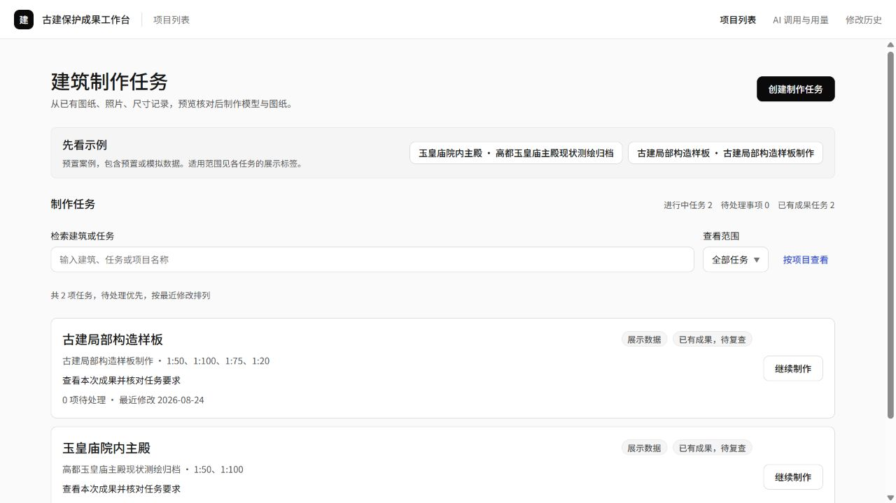

# 古建保护成果工作台

本产品面向古建测绘与文保勘察团队中的成果编制人员，帮助他们把已有照片、实测记录和历史图纸转成可编辑、可核对的模型与图纸，减少转写、建模和制图的人工工作。

当前处于制作案例阶段。完整人工对照和真实专业用户试点尚未开展，现有展示包不作为节省工时的证据。文档已按制作方向修订，代码迁移与验收进度见[路线图](文档/04_实施单元/00_路线图.md)。

[在线展示](https://heritage.jiajiajiang.com/) · [核心 PRD](文档/01_产品/01_核心PRD.md) · [文档索引](文档/00_索引.md) · [部署说明](deploy/部署说明.md)



## 制作任务

用户从首页继续建筑制作任务，提供资料后先看预览，再结合原件核对、修正和导出成果。

| 环节 | 用户操作 | 产品目标 |
|---|---|---|
| 资料与预览 | 定义任务，按三层要求提供照片、记录和图纸 | 先呈现支持范围的预览，再定位需要核对的对象 |
| 建筑建模 | 核对采用值、构件及必要关系 | 用已确认数据生成模型 |
| 图纸制作与检查 | 设置视图，核对尺寸和表达 | 从同一模型生成可编辑 DXF 与 PDF |
| 修正与导出 | 修改错误，检查更新结果并导出 | 保留已有成果，自动维护必要来源与历史 |

现有页面与文件能力已具备内部验证。普通输入、候选复用和完整制作过程按 V01 至 V04 继续验收，详见[用户旅程](文档/01_产品/02_用户旅程.md)与[界面方案](文档/01_产品/03_界面与交互形态.md)。

## 展示案例

公开展示保留两个已有成果项目，原始资料制作另用固定任务验证。

| 项目 | 用途 | 使用限制 |
|---|---|---|
| 高都玉皇庙主殿 | 查看、修订和导出已有模型与图纸 | 照片配合模拟测量数据，不是真实测绘成果 |
| 清式大木构造样板 | 展示参数化构件与多格式输出 | 不对应真实建筑，不作为专业参照标准 |
| Dai Loy HABS | 内部任务 T-DL-01、T-DL-02、T-DL-03 | 不在公开首页，不能证明中国古建普遍适用 |

公开站点已于 2026-10-10 更新制作流程与统一样式，网页资源、服务接口及发布后的浏览器复查均已通过；对应源码、README 与项目文档已同步至 GitHub 主分支，截图与结果见[检查记录](文档/05_验证证据/38_样式统一与在线更新/检查记录.md)。输入、输出、预置程度和验证状态见[演示项目定义](文档/01_产品/04_演示项目定义.md)。

## 责任与范围

AI 提供候选和修改建议，程序生成与检查文件，专业人员核对采用内容和成果质量。

来源性质与确认状态分别记录。人工确认不把推算或模拟值变成实测值。资料不足时补充资料或缩小成果范围，不推断不可见构造。

本阶段不接扫描设备，不建设原始点云自动重建，不提供修缮设计或结构安全结论。浏览器本机不能正式签发，展示包中的只读流程记录不具有真实工程效力。公开体验仅使用获准资料。

## 验证与费用

制作过程、质量、修改更新、人工耗时和真实用户反馈分别验证。

V01 至 V04 检查当前制作任务；V05 比较完整人工投入；V06 检查中国古建适用性；V07、V08 需要真实使用者和采购决策人。未开展项目明确保留状态，不预填收益。

AI 调用由用户主动发起，用量来自实际运行。历史单价只用于旧记录重算，完整制作成本还包括人工与计算投入。计时和成本规则见[制作验证与模型成本](文档/01_产品/05_模型成本与商业回报.md)。

## 技术与运行

现有工程由 React 工作台、TypeScript 业务包、Node 服务和 Python 制图 worker 组成。

本地项目保存在 IndexedDB，项目写入经统一命令入口。模型与 CAD 服务返回候选或成果，不直接写项目；密钥仅保存在服务端。结构与迁移见[技术架构](文档/02_技术/01_技术架构.md)。

### 本地运行

本地开发需要 Node.js 20.19 以上和 pnpm 11.16。查看内置项目不要求配置模型密钥。

```powershell
corepack pnpm install
corepack pnpm dev
```

工作台运行在 `http://127.0.0.1:5173`，Node.js 服务运行在 `http://127.0.0.1:8787`。

使用 AI 功能时，将 [`apps/server/.env.example`](apps/server/.env.example) 复制为 `apps/server/.env`，并在服务端填写 `KIMI_API_KEY`。使用本地几何与制图功能时，按照 [`workers/cad/requirements.lock`](workers/cad/requirements.lock)建立 Python 3.12 环境。

完整检查命令：

```powershell
corepack pnpm run install:legacy
node .claude/skills/quality-check/scripts/run-all.mjs --full
```

公网部署使用 Nginx 提供 HTTPS 和静态前端，`/api` 反向代理到 Node.js 服务。服务器配置和更新步骤见[部署说明](deploy/部署说明.md)。

代码位于 `apps`、`packages` 和 `workers`，产品与技术资料位于 `文档`，检查和部署脚本位于 `tools`。

## 许可

源代码与项目文档采用 [MIT License](LICENSE)，第三方资料遵守各自许可与授权条件。

照片、字体、历史图纸及外部参照保留对应来源，第三方许可不因本仓库采用 MIT 而改变。
