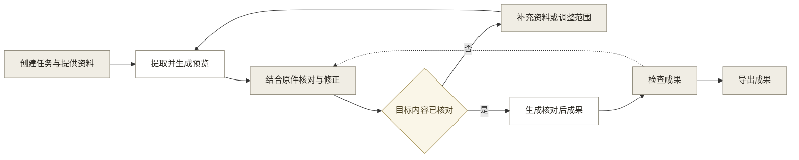

# 01 · 核心 PRD：古建保护成果工作台 v5.0

## 0. 项目任务摘要

本产品帮助古建测绘与文保勘察人员，把已有现场资料转成可编辑、可核对的模型与测绘图纸，减少资料转写、构件整理、建模和制图的人工工作。

**表 1：项目任务摘要**

| 项目 | 现行定义 |
|---|---|
| 第一用户 | 测绘或文保勘察团队中承担资料整理、建筑建模和图纸编制的专业人员 |
| 核心场景 | 现场资料已取得，需要根据照片、实测记录和历史图纸制作单栋建筑的模型与测绘图纸 |
| 主要价值 | 减少成果制作的人工操作和返工；来源、版本、历史和归档由系统辅助维护 |
| 当前阶段 | 形成经得起产品评审的可交互案例；真实用户试点、商业验证和正式交付尚未开展 |
| 当前输入 | 已有照片、实测表、带尺寸草图和历史图纸；本阶段不接入扫描硬件或建设点云自动重建能力 |
| 当前输出 | 资料支持范围内的构件化模型、平面、立面、剖面、可编辑 DXF、PDF 及必要说明 |
| 责任 | AI 提取候选并辅助修正；程序计算与生成文件；专业人员核对采用内容和成果质量 |
| 首页 | 建筑制作进展和待处理事项优先；项目管理作为辅助入口 |
| 主流程 | 创建任务与提供资料，生成可视预览，结合原件核对和修正，检查并导出 |
| 开工顺序 | 独立样板已完成；先验收正式文档，再实施产品代码；进度以路线图为准 |

## 1. 文档信息

v5.0 按 JIAJIA 于 2026-09-30 确认的方向，以成果编制人员为第一用户，采用先预览后核对的制作流程。

| 版本 | 日期 | 修订内容 |
|---|---|---|
| v3.0 | 2026-08-26 | 以资料、数据、成果和专业记录的连续关联组织产品 |
| v4.0 | 2026-09-05 | 改为成果制作任务，明确输入输出、专业边界和验证条件；配套文档已完成一致性修订 |
| v5.0 | 2026-09-30 | 按辅导 13 样板集中页面需求，明确首页进展、三层资料、对象数据和预览核对；实现状态见路线图 |

### 1.1 需求摘要

专业人员提供已有资料，先查看资料支持的模型、图纸或对象预览，再结合原件核对和修正。系统复用已采用数据生成可编辑成果，自动维护必要来源与历史。实际价值按第 2.5 节的人工投入与质量指标验证。

### 1.2 流程概览

成果制作先呈现可核对的预览，再修正并形成约定成果，如图 1 所示。

**图 1：成果制作流程**

**核心业务：**

1. 专业人员定义建筑任务并提供资料，系统展示可支持的预览和具体缺项。
2. 专业人员结合原件核对对象和尺寸，程序用采用数据生成同源模型和测绘图纸。
3. 专业人员修正成果，系统更新受影响内容并保留必要记录。
4. 专业人员导出可编辑文件和质量说明，系统附带来源与使用限制。

## 2. 需求背景

本轮优先检验已有资料能否更高效地转成成果，用户需求强度和节省工时尚未获得真实用户验证。

### 2.1 愿景

让古建测绘与文保勘察人员把时间用于现场信息和专业质量判断，减少资料转写、重复建模与制图工作。

### 2.2 目标用户

直接操作用户是成果编制人员，专业负责人负责复核，委托方接收输出。

**表 2：用户与验证状态**

| 角色 | 工作与产品关系 | 验证状态 |
|---|---|---|
| 成果编制人员 | 整理已有资料，制作与修正模型、图纸 | 第一用户已确认，真实使用行为未验证 |
| 项目负责人或专业复核人 | 判断资料采用范围，核对成果质量 | 责任角色已定义，正式身份与签发不在本阶段 |
| 委托方 | 接收文件及适用说明 | 当前不直接操作工作台 |
| 团队或所在单位 | 可能承担工具费用 | 买单方假设，需试点后验证 |

### 2.3 现状与问题

现有内部样本能够生成文件，但原始资料到成果的完整任务仍有输入和核对缺口。

- 资料处理：图纸尺寸可能错读，候选需要核对。
- 建模输入：TIFF 读取、原件核对和候选到制作输入的关联已接通；完整几何参数与成果覆盖仍需按固定任务验证。
- 成果修正：文件查看与导出已有内部验证，原始资料到可用成果的完整人工投入尚未测量。

**结果**：当前可展示完整成果，但不能报告真实项目的节省工时。

**根因**：已有验收主要检查文件、页面与记录是否完整，缺少同资料、同成果要求下的制作过程对照。依据见[演示项目定义](04_演示项目定义.md)及[制作验证与成本](05_模型成本与商业回报.md)。

### 2.4 行业趋势

扫描、数据处理、建模和制图是可分别验证的环节，新闻中的总耗时不能直接作为本产品指标。

极光新闻报道提供了成果制作效率的场景参考，但未公开完整操作、精度与计时范围。现场点云重建与本阶段的已有资料制作使用不同输入。相关来源和限制归入[AI 与制图能力边界](../06_研究底稿/01_AI与制图能力边界.md)，本产品不承诺单张照片恢复整栋建筑。

### 2.5 目标与价值

本阶段先证明可交互的制作过程成立，再以人工对照判断效率，所有阈值都是验收约定而非实测结果。

核心指标只保留两项：同质量下的人工操作总时长、目标成果质量通过情况。费用和等待作为成本分项记录。情景估算与计算过程见[制作验证与成本](05_模型成本与商业回报.md)第 3.3 节。

**表 3：验证条件**

| 编号 | 待验证问题 | 方法与通过条件 | 未通过处置 |
|---|---|---|---|
| V01 | 资料能否进入制作过程 | 固定一组原始资料和成果要求，从空项目开始；不导入完成项目包，不填写 JSON 即可完成目标任务 | 缺少入口或必须人工构造程序输入，判定制作流程未通过，先补对应能力 |
| V02 | 数据提取与可视核对是否减少重复录入 | 首批可读资料处理后先展示支持范围的预览；逐项记录原文、候选、采用值及人工修改；已采用数据不要求再次录入 | 修复预览、定位和重复录入，再测同任务与新增样本 |
| V03 | 生成文件是否满足约定质量 | 输入已明确的关键尺寸经单位换算后错误为 0；模型与图纸一致；DXF 可编辑；未知项不补造 | 对应成果不得计为任务完成，记录缺陷并修正或缩小明确范围 |
| V04 | 修正能否有效更新成果 | 改动一项尺寸并重新生成；相关模型与图纸采用新值，旧结果保留且状态明确 | 不能宣称修改自动生效；修复依赖或明确要求重新生成 |
| V05 | 是否节省人工制作时间 | 同资料、同成果要求、同质量门槛比较人工与产品；记录准备、核对、修正、等待；质量不下降且人工总用时更少才通过 | 不报告提效；定位增加工作量的环节，调整后重新测试 |
| V06 | 是否适用于中国古建 | 用具备独立尺寸依据的中国古建样本核对构件、形制与图面；仅对通过的对象和图种作结论 | 不将 HABS 或参数样板结果外推为中国古建完整能力 |
| V07 | 目标用户是否能独立使用 | 未参与开发的目标专业人员按任务书完成任务；记录开发者代操作和中断原因，不能依赖开发者填写隐藏参数 | 不宣称用户可独立完成；处理操作缺口后再次试用 |
| V08 | 使用方是否愿意付费 | 实际使用后分别询问使用者和采购决策人，记录预算、采购条件和明确意向 | 不设已验证价格或收入预测，不用项目采购总额代替软件付费证据 |

V01 至 V04 属本阶段制作案例验收。V05 可先做内部对照，只能称内部结果。V06 取决于合格中国古建资料，V07、V08 取决于真实用户参与，缺少这些条件时状态为未开展，不得代填通过。

具体样本、输入清单、测量记录和当前结果集中在[演示项目定义](04_演示项目定义.md)与[制作验证与成本](05_模型成本与商业回报.md)，其他文档仅引用验证编号。

### 2.6 市场和竞品分析

相关方案证明成果制作可以分环节改进，但不证明本产品的用户需求、自动化程度和收益。

**表 4：相关方案与边界**

| 类别 | 已有依据 | 对本阶段的约束 |
|---|---|---|
| 现场扫描与点云建模 | 厂商公开资料说明采集、数据处理、建模和编辑步骤 | 使用真实点云输入，不能与少量照片输入直接比较 |
| 资料理解与参数化出图 | 本项目已有转写、几何和 CAD 内部记录 | 需把用户准备输入和修改结果的工作计入验证 |
| 来源与项目记录 | 当前项目包与版本功能已有内部检查 | 保留辅助作用，不能替代制作任务验收 |

来源与能力限制见[AI 与制图能力边界](../06_研究底稿/01_AI与制图能力边界.md)。本阶段不以竞品页面数量或构件数量判断价值。

### 2.7 旧版本

旧版本保留作为历史决策与实现依据，当前目标和优先级以 v5.0 为准。

已完成单元的验收只证明当时范围。现行文档迁移未完成前，路线图必须列出差异，不能将旧阶段完成状态视为新目标已达成。

## 3. 业务流程

用户围绕制作成果操作，系统自动维护资料关联与必要历史，不增加独立的记录维护任务。

### 3.1 主流程与业务规则

每次制作先固定目标和资料范围，先生成支持范围的预览，再核对、修正和导出。

1. 首次任务必填任务名称、建筑名称、制作目的、目标成果与输出单位。当前目的为现状测绘，单位默认毫米且可见。比例、图幅和剖切设置在出图前确定。

   输出单位支持毫米、厘米、米，作用于可编辑 DXF 的模型坐标、长度标注及 IFC 单位和坐标。图纸明确说明长度单位，标高仍以米表达并注明。转换保持建筑物理尺寸、图幅和比例一致，保留可辨认的小数。改变单位后，原成果保留供查看，重新生成并检查后才符合本次要求。GLB 按格式规定使用米，内部采用尺寸继续使用毫米。

2. 数据来源与确认状态分别记录。人工确认不把推算值、演示值或资料转写值变成现场实测值。
3. 至少一份可读建筑资料即可开始处理。系统提取候选并呈现原图定位、对象列表或有依据的几何预览。几何条件不足时保留原图与对象，不补默认尺寸。
4. 待核对候选可进入明确标记的预览，核对后成果只采用用户已核对内容。冲突值不自动选定，缺项只影响相关对象或图种。用户可逐项或成组核对，成组处理绑定实际展示条目。
5. 同一组已确认数据供模型和图纸使用，不要求用户重复录入。
6. 技术检查、专业复核与正式签发分别表达。当前新建或修改项目不得在本机正式签发。
7. 修改保留旧成果，重新生成采用新数据；影响范围不完整时明确显示限制。
8. 导出包含可编辑成果、必要说明和来源；成果包回导保留数据关系。
9. 单个文件读取或对象生成失败时，其余可读资料和支持部分继续处理。作业失败保留输入和旧结果，提供重试；展示本次实际结果。
10. AI 用量由真实调用记录产生，被动浏览不调用模型。具体确认机制见[界面与交互形态](03_界面与交互形态.md)第七节。

### 3.2 用户故事

用户故事以成果制作及其质量为验收对象。

- P0：作为成果编制人员，我打开首页继续未完成的建筑任务，以便找到当前最需要处理的工作。
- P0：作为成果编制人员，我提供已有资料并查看可视预览，以便直接定位需要核对的对象。
- P0：作为成果编制人员，我结合原件核对尺寸与构件，以便减少重复转写和建模。
- P0：作为成果编制人员，我修改错误并查看更新后的结果，以便完成本次成果要求。
- P0：作为成果编制人员，我检查并导出可编辑文件，以便继续专业工作。
- P1：作为专业复核人，我按需查看采用依据和修改内容，以便定位成果问题。
- P1：作为项目负责人，我查看制作耗时和调用费用，以便判断实际收益。

### 3.3 任务与对象数据

建筑、构件、尺寸、资料和成果分别编号，名称变更与重新生成保持对象身份。

**表 7：业务数据要求**

| 对象 | 必需信息 | 可补充信息 | 来源与更新规则 |
|---|---|---|---|
| 制作任务 | 名称、建筑、目的、目标成果、输出单位、状态 | 项目或村落、任务模板、负责人 | 用户设置；模板为可修改初始选择，当前仅现状测绘；内部编号自动生成 |
| 建筑 | 名称、稳定编号、内部任务关联 | 管理分组、类型、年代说明、主要结构、地址 | 名称与属性由用户或原资料提供；内部关联自动建立；管理分组选填，未知属性留空 |
| 原始资料 | 文件、名称、类型、读取状态、对应建筑 | 记录时期、用途、对象位置 | 原件保留；派生图可定位回原图；相同文件可覆盖多项要求 |
| 尺寸候选 | 所属对象、名称、原值与单位、换算值、原文位置、核对状态；采用时区分长度与相对标高 | 测量元数据仅在原件存在时补充 | 提取结果先待核对；更改数值保留原候选和采用理由 |
| 构件 | 稳定编号、名称、类别、所属建筑、来源、几何状态 | 材料、父构件、位置、几何参数与关系 | 创建时编号；更新保持编号；位置无依据标为未知 |
| 位置与几何 | 原点、轴向、单位和参数的依据 | 标高基准、局部坐标、尺寸引用 | 原图区域和三维坐标分别记录；二维框选不直接成为三维位置 |
| 预览 | 当前资料与候选、对象定位、待核对和缺项清单 | 满足条件的几何与图面 | 待核对内容可见；未生成几何时不显示生成完成 |
| 核对后成果 | 任务、采用数据、模型或图纸、生成与检查状态 | 复核、限制说明 | 改动后重生成；旧结果保留，不继承旧检查结论 |

材料属性用于分类和说明，不据照片生成材质或结构安全结论。构件只编辑当前生成器支持的字段；其他构造列出所需资料。

**表 8：两个构件数据实例**

| 信息 | 矩形墙体实例 | 圆柱实例 |
|---|---|---|
| 编号与身份 | 创建时取得稳定编号 W-001 | 创建时取得另一稳定编号 C-001 |
| 名称、类型 | 内部测试墙、墙 | 内部测试柱、柱 |
| 几何参数 | 长 6000 mm、厚 240 mm、高 3000 mm | 半径 150 mm、高 3000 mm |
| 位置 | 中心为 3000、120、1500 mm | 中心为 0、0、1500 mm |
| 来源性质 | 内部测试设定 | 数据表达假设 |
| 材料 | 测试设定为砖 | 未知 |
| 修改核对 | 变更长度后编号保持，模型与图纸更新 | 毫米与米换算后几何一致，位置假设及材料未知状态保留 |

墙体数值来自 `apps/workbench/src/test/component-fixture.ts`。圆柱数值为数据表达假设，单位换算与未知材料仍待验证。单元 21 另用半径 200 mm、中心 6800、200、1500 mm 的内部圆柱及上述墙体，验证稳定身份、来源、尺寸引用、选择、保存、重新生成和独立库回导；浏览器将墙体长度改为 6100 mm、厚度改为 260 mm，当前模型同步更新。实测记录见[对象核对与制作衔接](../05_验证证据/30_对象核对与制作衔接/检查记录.md)。

### 3.4 资料要求与成果预期

资料按必需、建议、额外补充分层，覆盖状态随目标成果和新增资料更新。

**表 9：资料三层要求**

| 层级 | 资料 | 覆盖内容 |
|---|---|---|
| 必需 | 平面或可读草图、尺寸记录或带尺寸图纸 | 对象范围、尺度与主体位置；同一文件可同时覆盖 |
| 必需，选择立面 | 对应方向立面或可校准照片 | 方向、尺度和所选立面的表达依据 |
| 必需，选择剖面 | 指定剖面或构造记录 | 剖切位置、楼层、所需高度与厚度 |
| 建议 | 其他方向照片、历史图纸与说明 | 核对视图关系、记录时期和来源冲突 |
| 额外补充 | 详图、节点照片、局部尺寸 | 增加有依据的局部表达 |

“必需”表示完成所选成果的资料要求。首次预览只需一份可读资料；缺少立面资料时，仍可查看已有平面对象与缺项。增加资料后重新提取并更新预览，用户继续核对新增或变化的内容。

资料覆盖由用户对照原件登记，记录本建筑的平面、尺度、高度、指定立面或指定剖面依据及页码、方向、标注或剖切位置。同一文件可支持多项内容；覆盖按内容统计，资料层级表示准备顺序。文件可读及上传成功均不自动表示覆盖完成。最新登记为空、资料失效或不可读时显示缺项；修改目标后重新计算所需依据。覆盖记录支持资料准备，具体尺寸、构件和成果仍按各自流程核对。

### 3.5 异常与恢复

异常处理保留任务和已有结果，并提供能够继续工作的入口。

**表 10：异常出口**

| 触发 | 处理与反馈 | 继续条件 |
|---|---|---|
| 必填字段或目标成果为空 | 字段旁说明缺项，保留已填内容 | 补齐字段 |
| 文件不支持或读取失败 | 逐文件说明，提供替换或移除；其他可读文件继续 | 至少一份可读资料 |
| 全部文件不可读或提取为空 | 保留原件，说明未取得可用对象 | 换文件、补充资料或重试 |
| 尺寸或位置缺失 | 在对象和相关图种标记所缺依据 | 补依据；可继续查看已有内容 |
| 来源冲突或错读 | 并列原文与候选，不自动采用；可修正或驳回 | 用户完成相关核对 |
| 模型、AI 或制图失败 | 显示具体失败，保留旧结果和输入；不重复创建有效成果 | 修正后重试，或继续可用操作 |
| 修改已核对数据 | 标出受影响内容，新成果重新检查 | 重新生成和检查 |
| 未保存离开 | 提供继续编辑、保存后返回 | 选择后执行，保存失败留在原页 |
| 范围超出当前支持 | 列出具体对象或图种及缺少条件 | 明确调整任务或补资料；不改写原失败记录 |

长度须为正值，相对标高允许零和负值；相对标高不作为构件长度引用。新候选缺类型时由核对人员明确选择，旧正长度记录保留原义。整体被驳回或替代的候选不再提供当前采用值，已有采用事实留作历史。

预览由候选、来源及最新核对记录只读计算。合法图上区域可叠加，缺失或越界保留文字位置，并支持临时原图框选；临时定位不写入尺寸事实。核对清单导出保留原文、候选、最新值、类型、状态和来源说明，生成后可保存文件或复制内容。

## 4. 功能规划

本阶段保留四个模块，制作能力优先，项目记录在后台支持全过程。

### 4.1 版本规划

版本顺序为制作案例、真实使用验证和正式部署。

**表 5：阶段目标**

| 阶段 | 完成定义 |
|---|---|
| 当前制作案例 | 文档一致；V01 至 V04 通过；展示输入、操作、输出和失败边界 |
| 真实使用验证 | 取得合格样本与参与者，开展 V05 至 V08，不预填收益 |
| 正式部署 | 根据试点结论决定组织权限、真实身份和正式签发，不纳入当前验收 |

### 4.2 功能架构

M1 负责资料输入，M2 负责建筑建模，M3 负责图纸制作与检查，M4 负责文件导出和辅助记录。

来源、版本和调用记录由系统自动保存，仅在用户需要核对、恢复或判断费用时展开。

### 4.3 功能清单

沿用 F01 至 F18 编号，现有页面名称保留，普通输入能力包含在原功能范围内。P0 为完成制作案例所需能力，P1 为后续核对便利，P2 为跨项目扩展。

**表 6：功能范围与优先级**

| 编号 | 功能 | 页面 | 优先级 | 验收 |
|---|---|---|---|---|
| F01 | 创建任务与修改成果要求 | 任务卡 | P0 | 建筑、目的、目标与单位明确；图纸设置在生成前完成 |
| F02、F05 | 导入资料与可视核对 | 资料清单、尺寸核对、三维模型 | P0 | 三层要求明确；先预览后核对，采用值直接用于制作 |
| F04、F06 | 提取构件与记录可见现状 | 构件清单、现状记录 | P0 | 候选有来源，缺项明确，不编造不可见构造 |
| F07 | 生成预览与核对后模型 | 三维模型 | P0 | 待核对预览与核对后成果分开；支持范围内对象可选择并回到原件 |
| F08、F11 | 修正构件与保留修改 | 构件清单、修改历史 | P0 | 修正进入成果；跨项目构件库复用另列 P2 |
| F09、F10 | 处理制作问题 | 问题队列 | P0 | 问题关联目标成果，处理后可继续相关任务 |
| F12、F13 | 设置与生成图纸 | 图纸样式、成组图纸 | P0 | 无须填写程序数据；图纸可编辑、查看并核对 |
| F14、F15 | 检查成果与专业复核 | 检查与签发 | P0 | 质量与责任状态明确，技术通过不等于正式签发 |
| F03、F16、F17 | 首页进展、导出与修订 | 成果归档、项目列表 | P0 | 首页显示制作进展与待处理项；文件可导出、回导与修订 |
| F18 | AI 辅助制作与调用记录 | 工作区、AI 调用与用量 | P0 | 基于资料执行可用动作，真实记账，失败可恢复 |
| F11、F18 | 历史检索与跨运行费用对照 | 修改历史、AI 调用与用量 | P1 | 不增加制作录入，能按已有记录核对 |
| F08 | 跨项目构件复用 | 构件清单 | P2 | 新项目重新核对适用性与来源 |

### 4.4 需求范围

当前范围以已有资料制作单栋建筑的受限成果为界，不承诺任意建筑的自动重建。

- 必须完成：任务进展、普通资料输入、可视预览、原件核对、数据复用、模型与图纸生成、修正、检查和导出。
- 保留辅助：必要来源、状态、版本、修改历史、项目包和调用用量。
- 后续评估：跨项目构件库、独立档案平台、多人协作与正式签发。
- 本阶段不做：扫描设备接入、原始点云自动重建、缺资料的全建筑推断、修缮设计与结构安全结论。

专业质量以[质量基准](../02_技术/03_专业制图与建模质量基准.md)中与本次成果范围相关的条款为准。资料不足时缩小成果范围，不以补造数据满足完整图种要求。

### 4.5 页面需求与验收

页面按用户任务呈现已有结果、待处理内容和下一步，交互定义以下表为准。

代表原型为[创建制作任务](../03_辅导笔记/辅导13改进/创建制作任务原型.html)。后续页面按图 2 的入口和出口实现；原型中的出口示意不代表产品已经生成模型。

**图 2：主要页面流转**

**表 11：首页、任务与资料页面**

| 页面与功能 | 数据和首要内容 | 交互及结果 | 状态与验收 |
|---|---|---|---|
| 项目列表，F03 | 建筑名称、任务目标、制作状态、待处理数量、最近操作；项目分组可选 | 检索建筑或任务；筛选进行中、待处理、已完成；进入后恢复原任务；主操作为创建制作任务 | 空列表引导创建；100 条测试摘要可检索和筛选，模型与原文件按进入后加载；数量来自任务必需项，不以文件存在判完成 |
| 辅助项目管理，F03 | 同一批任务的项目分组与摘要 | 在项目列表切换分组查看；项目或村落为可选归属 | 不单建管理工作流，不要求先创建村落才能制作；切换视图不改变任务状态 |
| 任务卡，F01 | 第 3.3 节任务字段；附加属性折叠；原任务书按需展开 | 填写、保存草稿；选择目标成果更新资料要求；修改模板不覆盖已有资料；图纸设置后续补齐 | 名称、建筑、目标、目的、单位完整且至少一份资料可读才开始；字段错误就近显示；保存后重新进入内容一致 |
| 资料清单，F02 | 三层资料要求、原件列表、逐文件状态、对应目标覆盖 | 添加、移除、补充用途；主操作“生成预览”；选中原件可查看；派生图能定位回原图 | 空白、读取中、可读、失败分别显示；部分失败仍可处理；处理成功进入预览，失败可重试 |

首页测试规模为本项目验收约定，不表示已验证真实项目容量。首页默认突出待处理与进行中任务；来源、版本和内部编号不占任务卡主区。

**表 12：预览、核对与修正页面**

| 页面与功能 | 数据和首要内容 | 交互及结果 | 状态与验收 |
|---|---|---|---|
| 三维模型，F07 | 当前可支持的几何预览；对象列表、待核对和缺项；无几何时显示原图定位 | 选择对象联动原件、尺寸与问题；切换支持视图；可补资料、核对或重新生成 | 候选可先展示且标待核对；不要求全部候选先确认；无依据部位不绘制确定几何；两种实例选择和来源对应正确 |
| 尺寸核对，F05 | 选中对象的原图位置、原文、候选值与单位、采用状态 | 修正、采用或驳回；成组采用显示完整条目；已采用尺寸直接供构件使用 | 冲突项不预选；数值换算正确；核对状态与来源性质分开；无需重复输入同一尺寸 |
| 构件清单，F04、F08 | 分类、名称、位置、受支持参数；选中对象画布联动 | 普通表单编辑、引用已有尺寸；保存后标记需更新并重新生成 | 编号在重命名、修改和回导后保持；不支持实体说明缺口；保存失败保留表单和旧结果 |
| 现状记录与问题队列，F06、F09、F10 | 对象、可见现状、缺项原因、影响图种和处理入口 | 补资料、返回具体字段、保留未知或明确调整范围 | 问题位置可返回；非相关缺项不阻止已有部分查看；仅处理问题数量不代表任务完成 |

**表 13：出图、检查与导出页面**

| 页面与功能 | 数据和首要内容 | 交互及结果 | 状态与验收 |
|---|---|---|---|
| 图纸样式，F12 | 图种、图幅、比例、方向、剖切位置、图签 | 普通表单设置；展示局部图面预览；保存后可生成 | 非法比例、空范围与剖切缺项定位到字段；单位和目标对象明确；无须填写内部坐标文本 |
| 成组图纸，F13 | 本次图面、文件清单、模型来源、待检查项 | 生成或重新生成；选图查看；旧结果可切换；修改返回对象 | 作业状态真实；本次结果与采用数据一致；失败保留旧文件；预览与核对后文件分别标明 |
| 检查与签发，F14、F15 | 目标成果完整性、关键尺寸、文件编辑性、专业复核状态 | 检查；点击问题返回对象或图面；修正后重检 | V03 通过才能标本次成果完成；技术检查、复核和签发分别显示；本机只表达当前实际状态 |
| 成果归档，F16、F17 | 目标文件、版本、检查与使用范围、必要说明 | 查看和导出可编辑文件；项目包回导恢复关系 | 输出与清单一致；未完成目标清楚；原文件、采用关系及对象编号回导保持；正式交付按既有责任条件 |

**表 14：辅助页面与助手**

| 页面与功能 | 内容与操作 | 状态与验收 |
|---|---|---|
| 修改历史，F11 | 按需检索已有修改、原值新值和来源，返回对象 | 不新增历史填写任务；旧版本可看；缺失影响关系明确显示 |
| AI 调用与用量，F18 | 真实调用状态、耗时、计费用量、价格日期；从调用返回任务 | 未调用不显示消耗；未知费用不作零费用；实际调用失败可重试 |
| 助手，F18 | 根据当前对象执行提取、解释、定位和修改建议；编辑在中栏 | 浏览直接执行；实际修改显示内容后采用；同一修改不重复确认；可执行目录与实现登记一致 |

关键页面均需覆盖空白、运行、成功、失败与恢复。长任务禁止重复提交，返回后可查看实际运行状态。详细执行参数、动作目录和现有阶段映射见[界面与交互形态](03_界面与交互形态.md)，它们不另设产品需求。
