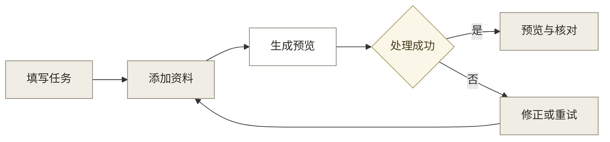
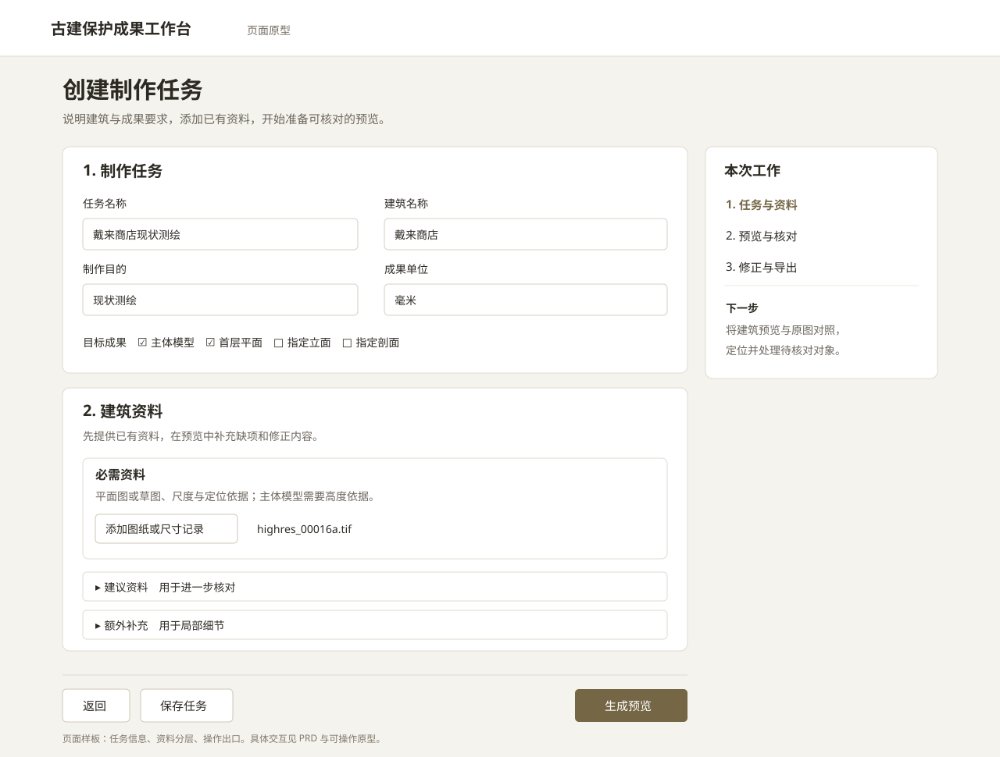

# 创建制作任务 PRD 样板 v0.2

## 1. 文档信息

本样板定义成果编制人员创建建筑制作任务并准备首批资料的一个页面，保留课堂演示的最小写法。

依据：辅导 13 录音 24:24 至 32:08、48:12 至 53:27。四段结构沿用课堂认可的模板，交互、异常、数据和验收集中在页面定义中。完整产品的需求扩展以本样板审阅结果为起点。

### 1.1 需求摘要

成果编制人员选择本次要制作的建筑成果，按提示上传已有图纸、尺寸记录和照片。系统说明首批资料可以支持的预览内容，让用户进入有原始资料可对照的核对过程。

### 1.2 流程概览

用户填写建筑任务、准备资料并开始处理，系统将资料和待核对预览交给下一页，如图 1 所示。

**图 1：本样板建议的任务流程**

**核心业务：**

1. 用户定义建筑对象和目标成果，系统按任务显示资料要求。
2. 用户提供建筑资料，系统准备可对照的预览与识别结果。
3. 用户进入建筑预览核对，定位问题并补充资料或修正结果。

## 2. 需求背景

本页解决的是用户开始制作前不知道该提供什么，以及材料与目标成果关系不明确的问题。

### 2.2 目标用户

目标用户是承担建筑模型与测绘图纸编制的专业人员。

- 特征 A：掌握建筑现场资料，需要把资料用于模型和图纸制作。
- 特征 B：需要判断识别内容是否对应实际对象，并修正错误。

用户范围沿用[核心 PRD](../../01_产品/01_核心PRD.md)第 2.2 节。具体使用行为仍需通过实际任务观察验证。

### 2.3 现状与问题

课堂演示中的资料清单缺少面向制作目标的输入引导。

- 资料要求：图片、表格和程序数据混合展示，用户不清楚应提供哪类资料。
- 结果预期：上传内容与能够生成的成果没有直接对应说明。

**结果**：用户上传后才发现缺少必要资料，或在尚未看到建筑对象时核对文字和数值。

**根因**：任务要求、资料要求和预览入口没有以同一次制作任务组织。依据为录音 27:39 至 31:43、39:54 至 42:38。

### 2.5 目标与价值

本页通过明确资料要求减少无效准备，并让用户尽早进入可视核对。

假设：用户按成果要求准备资料，比无分类上传更少出现补传和重复录入。验证方式：给目标成果编制人员相同资料和目标，比较完成资料准备的用时、补传次数与求助情况。

样板验收以第 4.4 节的连续操作为准。实际节省时间在完成对照后记录。

## 3. 业务流程

任务信息和资料在同一页完成，点击“生成预览”后进入“预览与核对”。

### 3.1 业务流程

本页先检查任务与可读文件，再处理资料；尺寸和构件的内容核对在预览中进行。

用户填写必填信息、添加资料后，可以保存任务或开始生成。本页首批预览的进入条件是至少一份可读取的建筑资料。三层清单说明所选成果的覆盖要求。缺项在预览中定位，已有部分仍可查看。处理成功后，下一页显示原始资料、可查看的模型或图纸，以及需要用户核对的对象。

处理失败后，用户返回本页修正资料或重试。

样板采用导师在 39:54 至 42:38 提出的“先结果、后核对”方案。JIAJIA 于 2026-09-30 确认成果编制人员优先，正式需求已按此方向扩展为核心 PRD v5.0。原型仍是单页交互示意。

### 3.2 用户故事

三个用户故事覆盖正常准备、资料补充和异常恢复。

- **P0**：作为成果编制人员，我说明建筑和目标成果，以便得到相应的资料准备要求。
- **P0**：作为成果编制人员，我提交已有资料并查看生成预览，以便结合建筑对象核对结果。
- **P1**：作为成果编制人员，我补充缺少的资料后继续处理，以便保留已完成的准备工作。

## 4. 功能规划

本样板只完整定义“创建制作任务”页及其进入、退出关系。

### 4.2 功能架构

任务定义和资料准备组成一个页面，后续预览是本页处理成功的出口。

### 4.3 功能清单

本页承接现行 F01 的成果要求和 F02 的资料输入，内容如表 1 所示。

**表 1：本页功能**

| **编号** | **功能** | **页面** | **优先级** | **验收** |
|---|---|---|:---:|---|
| F01 | 定义制作任务 | 创建制作任务 | P0 | 填写建筑和任务范围，资料要求随范围显示 |
| F02 | 准备制作资料 | 创建制作任务 | P0 | 按三类添加、查看清单和移除资料，缺项可定位 |
| F02 | 提交并进入预览 | 创建制作任务 | P0 | 成功进入预览，失败后保留信息并可重试 |

### 4.4 页面原型与验收

用户在一个页面完成任务定义与资料准备，主要操作为“生成预览”。

**图 2：创建制作任务页面原型**

可操作版本：[创建制作任务原型](创建制作任务原型.html)。图 2 表达信息和操作关系，页面最终视觉沿用产品设计规范。

**表 2：页面数据**

| **对象** | **字段** | **填写要求** | **使用方式** |
|---|---|---|---|
| 任务 | 任务名称、建筑名称 | 必填 | 命名任务并绑定制作对象 |
| 任务 | 制作目的 | 必填，样板为现状测绘 | 决定本次工作目的 |
| 任务 | 目标成果 | 必填，至少选择一项 | 显示相应资料要求 |
| 任务 | 成果单位 | 必填，默认毫米 | 统一输出；原件单位保留 |
| 建筑 | 所属项目或村落、类型、主要结构 | 选填 | 供任务识别和分类，空值不影响创建 |
| 资料 | 文件名称、资料类别、读取状态 | 添加资料后自动记录 | 归入三层清单并展示处理结果 |
| 处理 | 未开始、处理中、成功、失败 | 系统更新 | 控制主操作和恢复入口 |

导师提出的类型、结构和村落字段保留为选填属性，首个样板不要求用户补齐与本次目标无关的信息。具体资料内容要求见[最小任务清单](02_最小任务清单.md)第 2 节。

**表 3：交互与异常**

| **操作或状态** | **反馈与流转** |
|---|---|
| 添加资料 | 资料进入对应类别，显示名称和读取状态；可以移除 |
| 打开建议或额外资料 | 展开相应清单，说明其支持的细节 |
| 保存任务 | 保存本页填写内容和资料，再次进入时继续编辑 |
| 返回 | 已保存内容保留；有未保存变更时可选择保存后返回或继续编辑 |
| 生成预览 | 校验任务和首批资料，通过后进入处理中 |
| 必填信息或资料缺少 | 定位缺项并给出补充入口；已有资料支持的部分仍可处理 |
| 文件读取失败 | 指出具体文件，允许替换；其他可读资料继续处理 |
| 处理中 | 显示当前处理状态，避免重复提交；可以返回任务列表，稍后查看 |
| 处理失败 | 说明失败环节，可重试或返回修改资料 |
| 处理成功 | 进入预览与核对，携带本次任务、原资料及已处理内容 |

本页的验收条件是：

1. 从空白页面填写一个建筑任务，准备首批资料，进入预览与核对出口。
2. 分别移除必需、建议和额外资料，页面正确反映缺项或可继续状态。
3. 修改目标成果后，资料要求与选择保持对应。
4. 保存后重新进入，名称、成果选择与资料记录保持。
5. 缺少必填字段、文件读取失败和处理失败均可恢复，已有内容保留。
6. 正常操作不要求用户编写程序数据；页面中的每个字段可在表 2 找到定义。
7. 在 1280 px 宽度下，任务字段、资料清单和主操作均可读、可操作。
