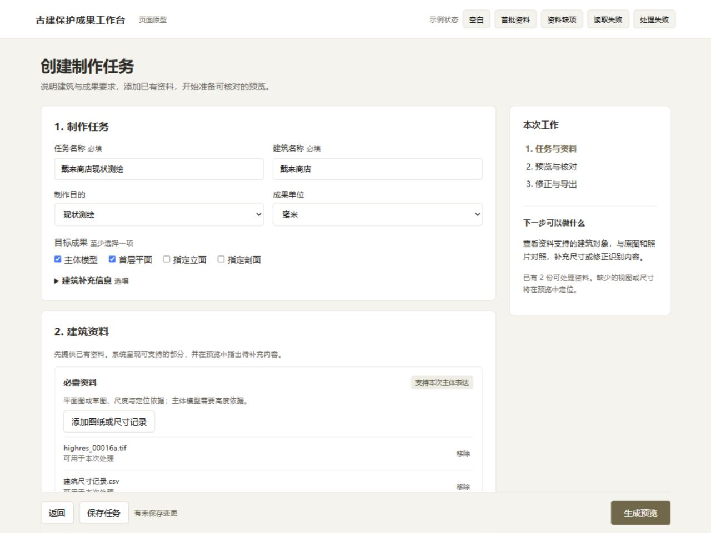

# 辅导 13 样板审查与验证

## 1. 当前结论

最小样板、正式文档、制作界面和在线发布已完成本轮修订；GitHub 同步、真实制作与价值验证尚未完成。

2026-09-30，主线程按产品分析、产品设计和文档撰写职责完成样板。独立产品审阅完整核对录音与现行资料，并复核样板及原型。检查范围为一个页面及其出口关系。

样板位于[01_最小 PRD 样板](01_最小PRD样板.md)，执行顺序与资料要求位于[02_最小任务清单](02_最小任务清单.md)，页面为[可操作原型](创建制作任务原型.html)。

## 2. 课堂要求核对

样板已包含导师要求的完整页面定义，表 1 记录后续项目修改的状态。

**表 1：课堂要求与执行状态**

| **录音时间** | **要求** | **当前状态** | **后续完成条件** |
|---|---|---|---|
| 51:33 至 53:27 | 最小 PRD 样板 | 四大类、三个用户故事、一个页面及验收已完成 | 已按样板扩展 PRD v5.0，文档检查与独立复查通过 |
| 52:29 至 53:27 | 原型、交互、异常、状态、数据 | 样板与 PRD 第 4.5 节已集中定义 | 产品实现逐项对应并实际运行 |
| 27:39 至 31:43 | 必需、建议、额外资料 | 单元 17、18、22 已实现三层、逐份读取及人工成果覆盖登记 | 登记与缺项内部验收通过；固定建筑完整制作另验收 |
| 39:54 至 44:43 | 先呈现结果再核对 | 单元 19、21、24 已实现候选、原件核对、待核对局部形体、修正及制作衔接 | 真实识别及完整建筑制作按独立条件验证 |
| 24:24 至 27:39 | 任务属性与单位 | 单元 17 已实现任务属性、单位和目标成果 | 单元 23 三单位实际转换、回读及恢复已通过 |
| 11:18 至 18:43 | 业务价值量化 | 已明确意图分发口径与假设估算；完整基线尚未取得 | 已补两项指标、情景估算与复算；待同任务实际对照 |
| 18:43 至 23:35 | 首页成果与进展 | 单元 16 已实现建筑制作任务、待处理、检索及辅助管理 | 已完成内部测试与桌面浏览器验收 |
| 32:14 至 38:07 | 对象、属性、编号和数据规范 | 单元 21 已验证两种内部对象稳定身份、来源、保存、生成、修订和独立库回导 | 单位转换已通过；未知材料的原假设仍需验证 |
| 38:11 至 39:13 | 页面信息精简 | 样板突出任务、资料和下一操作 | 对实际页面逐项检查无用内容 |
| 47:21 至 49:27 | PRD 与研究依据集中 | PRD 已集中页面需求，旅程与界面重复已精简 | 保留 PRD 与研究主入口，工程与证据按需阅读 |
| 54:17 至 01:04:15 | Agent 原则与提示词减法 | 七角色已精简并做同任务个案复查 | 选小任务比较精简前后质量，记录保留与删除依据 |
| 36:20 至 38:07 | 数据规范与 Revit 方向 | 已核对官方 IFC 与 Autodesk 依据 | 交换检查已定义；Revit 实机未验证 |

## 3. 原型实际操作

主线程在浏览器完成表 2 的操作，正常、缺项和恢复路径均符合当前单页定义。

**表 2：2026-09-30 浏览器检查**

| **检查** | **实际结果** |
|---|---|
| 空白任务提交 | 提示填写任务名称并定位字段 |
| 任务已填、没有资料 | 保留名称，提示添加至少一份可读资料 |
| 只有一份资料 | 可以进入“预览与核对”出口 |
| 部分文件读取失败 | 失败文件显示替换提示，其余可读资料可以处理 |
| 处理服务失败 | 任务和资料保留，显示重试及返回入口 |
| 失败后重试 | 进入正常出口，任务内容保持 |
| 目标成果为空 | 提示至少选择一项，保留资料 |
| 选择剖面 | 资料提示增加剖切位置与构造要求 |
| 保存后重新进入 | 名称、目标成果和资料记录保持 |
| 未保存时返回 | 可选择继续编辑或保存后返回 |
| 真实文件添加 | 本地公开照片添加后显示名称与状态 |
| 移除全部资料 | 清单和状态清空，提交时显示重新添加入口 |
| 1280 px 显示 | 任务字段、资料及主操作可读，主操作在滚动时可达 |

真实照片为既有公开样本，文件内容只在本地原型读取。文件选择器返回较慢，该耗时未计入产品处理效率。预览与任务列表是页面出口示意，本轮未验证模型、图纸的实际生成。

## 4. 审阅发现与处理

审阅发现的三处行为差异已经统一。

1. 首批资料条件明确为至少一份可读建筑资料，资料清单说明所选成果的覆盖要求。
2. 单个文件读取失败与其他文件处理分别展示，可读部分继续处理。
3. “查看资料”改为“查看清单”，本页负责准备，原件对照在下一页完成。

PRD 机器检查结果为 0 项问题、0 项警告。文档引用检查通过，新样板无格式建议项；历史辅导 6、7 的原有空格提示不属于本轮新增内容。

## 5. 当前实施顺序

第一用户方向已确定，正式文档验收后进入代码实现。

JIAJIA 于 2026-09-30 确认成果编制人员优先：首页突出建筑制作进展和待处理，管理视图作为辅助入口。正式需求、数据与页面验收集中进入核心 PRD v5.0；文档单元为 15_辅导13需求与文档收敛。后续依次修改任务与首页、原始资料输入、预览核对，再实际运行固定案例。

文档收口证据见[检查记录](../../05_验证证据/24_辅导13文档与角色/检查记录.md)，当时完整检查八项通过，共 563 项测试。后续产品实施见第 6 节。

## 6. 2026-10-01 产品实施结果

单元 17 至 23 完成任务创建、原始资料、候选核对、对象制作衔接及资料覆盖，固定案例真实识别尚未通过。

首页、单页设置与三层资料已接入；TIFF 保留原件并生成同坐标 PNG，PDF、文本及其他图像逐份显示可读状态。预览并列原标注、毫米候选、类型、来源位置和最新采用值，采用与修正沿用既有命令，零与负相对标高不用于构件长度。内部浏览器检查和 605 项测试通过，证据见[预览核对](../../05_验证证据/28_预览核对/检查记录.md)。

单元 21 实际验证墙体、圆柱模型的对象选择、原件区域、采用尺寸、直接输入修改和刷新恢复；独立库回导保留身份与来源。读取失败及恢复与专业问题分别处理，28 项定向及 630 项完整回归通过。证据见[对象衔接](../../05_验证证据/30_对象核对与制作衔接/检查记录.md)。

单元 22 验收 7/7，通过，同文件多用途、具体位置、目标变化、清空及独立库恢复已验证。覆盖记录与尺寸分开；修正后 642 项测试通过，证据见[资料覆盖](../../05_验证证据/31_资料与成果覆盖/检查记录.md)。

单元 24 验收 9/9，通过；候选尺寸可先形成待核对局部形体，核对保存后生成模型，材料未知按缺项保留。711 项测试、实际浏览器及独立库恢复通过，证据见[待核对三维预览](../../05_验证证据/33_待核对三维预览/检查记录.md)。

单元 25 验收 6/6，通过；提示使用独立空间，窄屏助手不再覆盖提示。三档实际布局、保留提示继续保存、错误关闭后草稿保留及 711 项测试通过，证据见[操作提示](../../05_验证证据/34_操作提示与按钮可达/检查记录.md)。

完整制作的输入条件仍未满足。TIFF 读取缺口已由单元 18 处理；T-DL-01 仍缺楼层高度、构造厚度、开口与定位、屋顶细部及视图坐标依据，具体对象和恢复条件见[原资料预检](../../05_验证证据/23_T-DL-01资料预检/预检记录.md)第三节。软件修复不能代替这些资料。若采用按图量取，需另定任务、校准和误差标准；当前未改变原任务，也未生成补测记录。

复制导出 CSV、JSON 已实际取得；原生下载未确认。单元 23 单位转换验收通过，证据见[输出单位转换](../../05_验证证据/32_输出单位转换/检查记录.md)。T-DL-03 尚待真实模型运行；完整制作、人工效率对照和目标专业人员独立试用分别继续验证。

## 7. 2026-10-02 逐屏与流程复查

单元 26 为 8/8，通过；实际逐屏发现的问题已按最小改动处理，完整制作资格未改变。

设计师实际巡检全部 14 个注册视图和首页，产品经理按录音时间核对资料、先预览、原件核对、修正、制作及输出。主代理实际复走关键状态，修正表单覆盖、候选定位、助手空间、目标成果入口及来源用语。仅模型内部任务无需出图配置即可生成局部模型并导出项目包，独立恢复检验通过。714 项测试与八项完整检查通过，证据见[主代理复查](../../05_验证证据/35_逐屏体验与流程审查/主代理复查.md)。

正式草案按所选成果的条件、真实 AI 识别、完整建筑制作、原生下载落盘及 V01 至 V08 仍待验证，未以界面验收替代。

## 8. 2026-10-03 仅模型成果出口

单元 27 为 8/8，通过；内部仅模型任务已完成文件检查、待签发草案及原生 ZIP 下载恢复。

模型下一步进入检查，文件核对通过可建草案；输入或来源候选失效时提示待更新，模型与图纸目标改变后不复用旧检查。产品经理的两项必修已复验，设计截图复查无剩余必修。主代理实际复走，并直接读取下载文件验证全部成果字节、来源、检查及草案在独立库恢复；GLB 与当前模型字节一致，JSON 项目记录与 ZIP 相符。740 项测试与八项完整检查通过，证据见[检查记录](../../05_验证证据/36_仅模型检查与成果草案/检查记录.md)。

该结果来自内部合成局部模型。真实 AI 识别、完整建筑、其他未测试格式下载、效率对照及专业人员试用仍按固定任务验证。

## 9. 2026-10-10 收尾核对

本轮界面改进已上线，项目完整验收与公开仓库同步仍有未完成项。

| 事项 | 状态与依据 |
|---|---|
| 导师制作链路 | 已实现任务、资料准备、先预览、原件核对、修正、制作与导出；内部案例复走见证据 35 至 37 |
| 页面样式与线上发布 | 已统一下拉框与表单布局，公开首页、创建表单、菜单及 Escape 操作复查通过，见证据 38 |
| README | 本地叙事与线上状态已更新，本次替换旧首页配图；公开 GitHub 页面仍是旧版 |
| GitHub | 接口确认主分支为 2026-08-26 的 `ea2bae2`；源码与 README 尚未同步。本机 Git 连接被重置，GitHub 应用无写权限 |
| 本轮检查 | 文档与引用、单元状态、测试写法、角色适配检查通过；类型检查在正常本机环境复验通过。本次仅更新文档与配图，未重复运行此前已通过的完整测试 |
| 原始资料完整制作 | T-DL-01 的资料缺项仍存在；T-DL-03 的外部模型传输待确认 |
| 业务价值 | 完整人工对照与真实用户试用未开展；50% 是情景估算，关键尺寸零错误是验收目标 |
| 简历 | 仅给出建议文字，不修改文件。JIAJIA 确认没有其他计时与零错误记录，同意按估算和验证目标表述 |

“中英文文档已公开”缺少现行依据，当前仓库未发现英文 README。公开案例的 1186、1258 个构件与 20、24 项成果来自演示包清单，可以保留并明确为预置案例。导师录音中的工时示例用于说明价值判断方法，不构成本项目的实际收益。

50% 的具体口径为《模型成本与商业回报》第 3.3 节的情景估算：人工组假设 480 分钟，产品组假设 240 分钟。后续以同资料、同目标、同质量要求的实际计时替换假设；关键尺寸零错误按约定核对项验收，当前不列为已取得结果。

2026-10-10 再次检查 GitHub 连接：插件当前账号为 `nyyname`，目标仓库属于 `jiajiajiang91-design`，接口返回当前账号无推送权限。本机 Git 重试仍因连接重置失败，未创建同步提交，也未推送。需重新连接有目标仓库写入权限的账号。09:07 英国夏令时开始本次检查，用量降至剩余 2% 后保存进度，按开始时间五小时后安排复查；简历文件保持原样。
